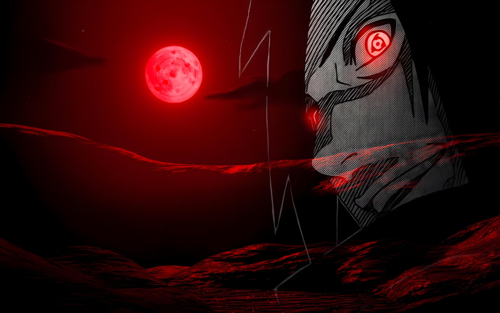

<!-- ================= MADARA UCHIHA THEME ================= -->
<div align="center">



</div>
<div align="center">


<br/>

<a href="https://github.com/TAMILSELVANM30">

</a>
<a href="https://github.com/TAMILSELVANM30?tab=followers">

</a>
<a href="https://github.com/TAMILSELVANM30?tab=repositories">

</a>

<br/>


</div>

---

## 🔴 About Me

```yaml
name: "Tamil Selvan"
role: "AI & Full-Stack Developer"
education: "B.Tech Artificial Intelligence and Data Science"
college: "Dr. N.G.P Institute of Technology"

interests:
  - Artificial Intelligence
  - Software Engineering
  - Full-Stack Development
  - SQL and Database Management
  - Data Structures and Algorithms
  - Automation

currently_learning:
  - Java
  - Python
  - React
  - Backend Development
  - AI and Machine Learning

philosophy: "Learn by building. Improve through practice."
```

- 🔭 Building practical software applications and developer tools.
- 🗄️ Interested in SQL, databases, backend systems, and performance.
- 🤖 Exploring Artificial Intelligence and Machine Learning.
- 🐍 Developing applications using Python.
- ☕ Practicing Java and Data Structures & Algorithms.
- 🌐 Exploring modern web technologies and full-stack development.
- 🏆 Participating in coding contests and technical activities.
- 💡 Passionate about transforming real-world problems into technical solutions.

---

## ⚔️ Tech Arsenal

<div align="center">

### 💻 Programming Languages


### 🌐 Frontend Development


### ⚙️ Backend Development


### 🗄️ Databases


### 🤖 AI & Machine Learning


### 🔧 Tools & Platforms


</div>

---

## 🔥 Featured Projects

<table>
<tr>
<td width="50%" valign="top">

### 🌦️ Weather Log Parser

**Weather Data Analysis Application**

A lightweight web application built using Python and Flask to upload, parse, display, and analyze weather log data.

**Technologies**

`Python` `Flask` `HTML` `CSS`

<a href="https://github.com/TAMILSELVANM30/-weather-log-parser">

</a>

</td>

<td width="50%" valign="top">

### 🩺 HealthWise Assistant

**AI-Based Health Assistance**

A mini project that uses user-provided symptoms to provide a disease prediction and health-assistance experience.

**Technologies**

`Python` `Machine Learning` `AI`

<a href="https://github.com/TAMILSELVANM30/healthwise_assistant">

</a>

</td>
</tr>

<tr>
<td width="50%" valign="top">

### 🌱 AgriMind AI

**Farmer Decision Intelligence Platform**

An AI-powered agricultural decision-support concept to help farmers compare market prices, buyer bids, and selling opportunities.

**Technologies**

`Python` `LLM` `React` `Machine Learning`

</td>

<td width="50%" valign="top">

### 🗺️ Geospatial Intelligence Mapping

**AI-Powered Local Facility Mapping**

A spatial intelligence project focused on verifying, mapping, and analyzing local facilities and amenities.

**Technologies**

`Python` `GeoPandas` `Leaflet` `AI`

</td>
</tr>
</table>

---

## 📊 GitHub Statistics

<div align="center">


</div>

---

## 🔥 GitHub Streak

<div align="center">


</div>

---

## 📈 Contribution Graph

<div align="center">


</div>

---

## 🏆 My GitHub

<div align="center">

<a href="https://github.com/TAMILSELVANM30?tab=repositories">

</a>

<a href="https://github.com/TAMILSELVANM30?tab=followers">

</a>

</div>

---

## 🤝 Connect With Me

<div align="center">

<a href="https://github.com/TAMILSELVANM30">

</a>

<!-- Add your LinkedIn URL here -->

<!--
<a href="YOUR_LINKEDIN_URL">

</a>
-->

<!-- Add your email address here -->

<!--
<a href="mailto:YOUR_EMAIL">

</a>
-->

</div>

---

<div align="center">

### 🔴 "Wake up to reality. Build your own world through code."

**— Inspired by Madara Uchiha**


⭐ If you find my projects useful, consider giving them a star!

**THE WILL OF FIRE NEVER FADES.**

</div>
